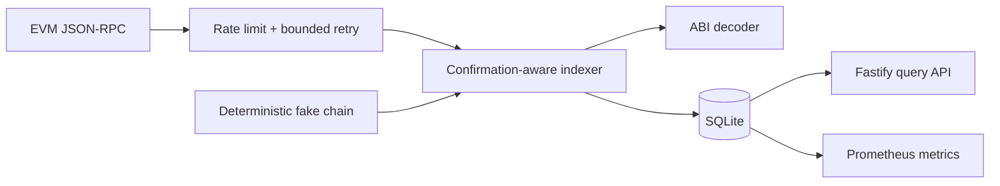

# Architecture

## Scope

ChainIndex indexes events from one configured EVM contract stream into SQLite.
It is designed as a small reference service: one process owns ingestion and the
read API, while provider and storage boundaries remain replaceable.

## Ingestion Invariants

1. Only blocks at or below `head - confirmations` are eligible.
2. Every processed block header is stored, including blocks with no matching log.
3. A batch is accepted only if parent hashes are contiguous and every log's
   `blockHash` matches the fetched header.
4. Blocks, normalized events, and the stream checkpoint commit in one transaction.
5. `(chain_id, stream_id, transaction_hash, log_index)` is unique, so replay is
   idempotent.
6. Before new work, the indexer compares its last stored block with JSON-RPC and
   walks backward to a common ancestor when hashes differ.
7. Rollback deletes orphaned blocks and cascading events, then rewinds every
   affected stream checkpoint and backfill job on that chain.

## Persistence

- `indexed_blocks`: canonical hash and parent linkage by chain and height.
- `events`: normalized event identity, ordering fields, topic, name, and JSON args.
- `checkpoints`: next live block per chain/stream.
- `backfill_jobs`: durable range and next block for resumable historical work.

SQLite uses WAL and `synchronous=NORMAL` for file-backed databases. The schema is
created transactionally at process startup. A production multi-writer deployment
would move the same constraints and transactions to PostgreSQL.

## Provider Boundary

`ChainProvider` exposes only `getBlockNumber`, `getBlock`, and `getLogs`.
`EthersJsonRpcProvider` supplies production JSON-RPC access;
`ResilientProvider` serializes requests, enforces a start-rate ceiling, and applies
bounded exponential retries. `FakeChainProvider` deterministically mines and
replaces blocks for tests and benchmarks.

Because the boundary is this narrow, the same `EthersJsonRpcProvider` used in production
is what the real-node E2E suite drives against anvil or `hardhat node` — the tests
substitute the *chain*, not the client. That is also why the ethers-to-viem question is a
contained one; see the README's dependency rationale.

## Test Topology

- `tests/indexer/`: `FakeChainProvider`, in-memory SQLite, no I/O. Fast tier.
- `tests/e2e/`: a real node over HTTP with the real compiled escrow, including a
  snapshot/revert reorg that forces genuine block-hash divergence.
- `tests/contract/`: Hardhat behavioural and adversarial contract tests.
- `tests/foundry/`: Solidity fuzz and invariant tests over the escrow's state space.

The fake tier proves the logic; the real-node tier proves the logic holds against an
actual JSON-RPC implementation. Both are kept because they fail for different reasons.

## API

- `GET /health`
- `GET /v1/events` with chain, stream, address, event, block-range, cursor, and limit filters
- `GET /v1/checkpoints`
- `GET /v1/backfills`
- `GET /metrics` in Prometheus text format

The API is deliberately read-only. Backfills are operator CLI actions so public
HTTP traffic cannot trigger unbounded RPC or storage work.
